# Konuşan Cüzdan

Down sendromlu çocukların günlük alışverişte parayı bağımsız kullanmayı öğrenmesi için geliştirilmiş, sesli ve görsel yönlendirmeli bir para hesaplama uygulaması. Çocuk elindeki parayı banknot ve madeni para resimlerinden seçerek cüzdanına girer; bir ürün seçtiğinde uygulama hangi paraları vereceğini hesaplayıp ekranda parlatır ve alacağı para üstünü sesle anlatır. Bütün veriler internet gerektirmeden telefondaki SQLite veritabanında saklanır.

Proje, YAZ305 Mobil Yazılım Geliştirme dersi (2026-27 Güz) ara sınavı için **Proje 13 – Para hesaplama uygulaması: Cüzdan** konusunda Flutter ile geliştirilmiştir.

## Özellikler

- **Resimlerden para girişi:** 5 kuruştan 200 TL'ye kadar 11 küpür; paraya dokunarak ya da sürükleyerek cüzdana ekleme, dokunarak çıkarma.
- **Verilecek paranın gösterilmesi:** Uygulama cüzdandaki paralardan en az para üstü ve en az sayıda parayla ödeme planını hesaplar (sınırlı sırt çantası / bounded knapsack dinamik programlama). Verilecek paralar parlar, çocuk onları kasaya verir.
- **Para üstünün gösterilmesi:** Para üstü en az sayıda paraya bölünür, paralar sırayla ekrana gelir ve cüzdana eklenir.
- **Sesli ve görsel yönlendirme:** Her ekranda kısa Türkçe sesli yönerge, "Tekrar dinle" butonu, konuşma balonlu maskot, ses efektleri ve konfeti.
- **Paran yetmiyor ekranı:** Eksik tutar ve eksik paralar gruplanmış olarak gösterilir.
- **Oyun:** "Hangi parayı verirsin?" soruları, yıldız sayacı ve ipuçları; sonuçlar veritabanına kaydedilir.
- **Geçmiş:** Yapılan alışverişlerin listesi; karta dokununca alışveriş sesli özetlenir.
- **Eğitmen paneli (PIN korumalı):** 3 zorluk seviyesi (bkz. [Zorluk Seviyeleri](#zorluk-seviyeleri)), ses ayarları (hız, ton, efektler), ürün ekleme/silme, oyun ilerlemesi ve veri temizleme.
- **Çevrimdışı:** İnternet bağlantısı gerekmez.

## Kullanılan Paketler

| Paket | Amaç |
|---|---|
| `provider` | Uygulama durumunun (cüzdan, ürünler, ayarlar) bütün ekranlara dağıtılması |
| `sqflite`, `path` | Cihaz üzerinde SQLite veritabanı |
| `flutter_tts` | Türkçe metin okuma (sesli yönergeler) |
| `audioplayers` | Ses efektleri ve isteğe bağlı kayıtlı insan sesi |
| `confetti` | Başarılı ödemede konfeti animasyonu |
| `sqflite_common_ffi` (dev) | Testlerde bellek içi veritabanı |

## Kullanılan Teknolojiler

| Araç | Sürüm |
|---|---|
| Flutter | 3.35 veya üstü (stable) |
| Dart | 3.9 veya üstü |
| Hedef platform | Android (iOS'ta da derlenebilir) |
| Editör | Visual Studio Code |
| Emülatör | Android Emulator – Medium Phone, API 35 |

## Proje Yapısı

```
lib/
├── main.dart                      # Uygulama girişi, Provider ve tema
├── data/
│   └── database_helper.dart       # SQLite tabloları ve sorgular
├── models/
│   ├── denomination.dart          # Türk lirası küpürleri
│   ├── product.dart               # Ürün modeli
│   └── transaction_record.dart    # Alışveriş kaydı
├── services/
│   ├── payment_calculator.dart    # Ödeme (dinamik programlama) ve para üstü
│   ├── money_formatter.dart       # Tutar biçimlendirme ve fiyat girişi
│   ├── speech_service.dart        # Türkçe metin okuma (TTS)
│   ├── voice_guide.dart           # Kayıtlı ses / TTS seçimi
│   ├── audio_phrase_service.dart  # Ses parçalarından cümle kurma
│   └── sound_service.dart         # Ses efektleri
├── state/
│   └── app_state.dart             # Cüzdan, ürünler, ayarlar (ChangeNotifier)
├── utils/
│   ├── theme.dart                 # Renkler ve yazı tipi
│   └── transitions.dart           # Sayfa geçiş animasyonları
├── widgets/                       # Para görünümü, maskot, PIN ve fiyat tuş takımları
└── screens/                       # 10 ekran: açılış, ana sayfa, cüzdan, alışveriş,
                                   # ödeme, para üstü, oyun, geçmiş, yardım, eğitmen paneli
assets/
├── images/                        # Maskot, ikonlar, kasa ve ürün görselleri
├── sounds/                        # Dokunma, bozuk para, başarı, tekrar dene sesleri
├── voice/                         # (isteğe bağlı) kayıtlı insan sesi
└── fonts/                         # Baloo 2
screenshots/                       # README ekran görüntüleri
test/                              # Birim testleri
```

## Veritabanı

Veriler `konusan_cuzdan.db` dosyasında, cihaz üzerinde tutulur.

| Tablo | İçerik |
|---|---|
| `wallet` | Cüzdandaki her küpürün adedi |
| `products` | Ürünler (10 hazır ürünle başlar) |
| `transactions` | Alışveriş geçmişi: tarih, ürün, fiyat, ödenen tutar, para üstü |
| `transaction_items` | Her alışverişte verilen ve alınan paralar |
| `progress` | Oyun sonuçları |
| `settings` | Seviye, PIN, konuşma hızı, ses tonu |

Bir alışveriş tek bir veritabanı işleminde (transaction) kaydedilir; bir adım hata verirse hiçbiri kaydedilmez.

## Çalıştırma Adımları

1. Flutter kurulumunu kontrol edin:

   ```
   flutter doctor
   ```

2. Projeyi klonlayın:

   ```
   git clone https://github.com/meileyy/konusan_cuzdan.git
   cd konusan_cuzdan
   ```

3. Paketleri yükleyin:

   ```
   flutter pub get
   ```

4. Emülatörü ya da telefonu bağlayıp uygulamayı çalıştırın:

   ```
   flutter run
   ```

> Sesli yönergeler için cihazda Türkçe metin okuma sesi yüklü olmalıdır. Yüklü değilse eğitmen paneli nasıl yükleneceğini gösterir (Ayarlar → Sistem → Diller → Metin okuma → Google Konuşma Hizmetleri → Ses verilerini yükle → Türkçe).
>
> Eğitmen panelinin varsayılan PIN'i **1234**'tür; panelden değiştirilebilir.

## Testler

```
flutter analyze
flutter test
```

- Ödeme algoritması: tam para, en az fazla ödeme seçimi, paranın yetmemesi
- Tutar biçimlendirme ve binlik ayraç (ör. 40.000 TL, 17,50 TL)
- Fiyat girişinin kuruşa çevrilmesi ("10.000", "17,50", "17.50" ve geçersiz girişler)
- Sesli okuma için sayıların ses parçalarına bölünmesi

## Zorluk Seviyeleri

Eğitmen, çocuğun düzeyine göre eğitmen panelinden 3 seviyeden birini seçer. Seviye arttıkça kullanılabilen paralar ve alışveriş ürünleri artar.

| Seviye | Kullanılabilen paralar | Alışveriş ürünleri | Örnek |
|---|---|---|---|
| 1 | 5, 10 ve 20 TL banknotlar | Elma, Su, Ekmek, Meyve Suyu (5–20 TL) | Cüzdanda 20 + 10 + 5 = 35 TL |
| 2 | Bütün banknotlar (5–200 TL) ve 1 TL | + Defter, Süt, Muz, Oyuncak (35–150 TL) | Cüzdanda 10 + 5 = 15 TL; 200, 100, 50 TL ve 1 TL eklenebilir |
| 3 | Kuruşlar dahil bütün paralar (5 kr – 200 TL) | + Simit (17,50 TL), Dondurma (27,50 TL) | Cüzdanda 10 + 5 + 1 TL + 50 kr = 16,50 TL |

<table>
  <tr>
    <th>Seviye 1</th>
    <th>Seviye 2</th>
    <th>Seviye 3</th>
  </tr>
  <tr>
    <td>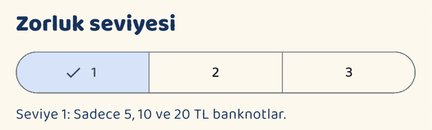</td>
    <td>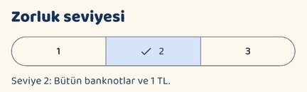</td>
    <td>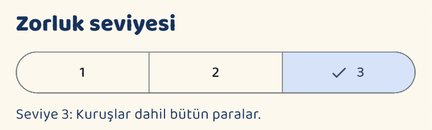</td>
  </tr>
  <tr>
    <td>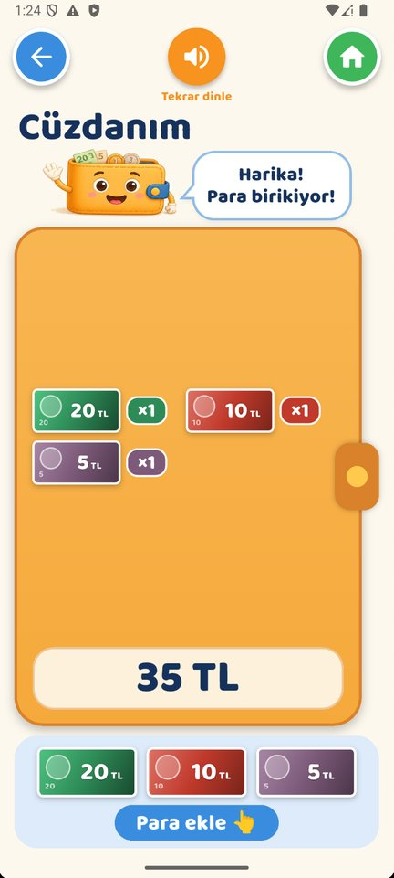</td>
    <td>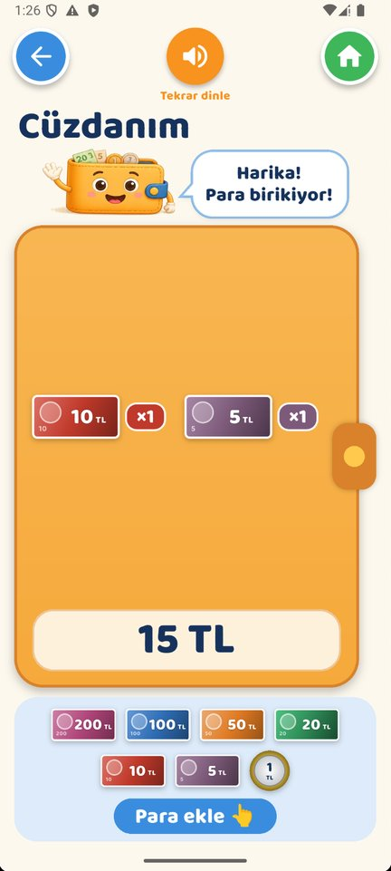</td>
    <td>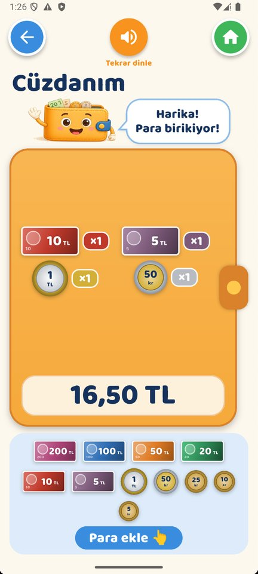</td>
  </tr>
</table>

## Ekran Görüntüleri

<table>
  <tr>
    <th>Ana Sayfa</th>
    <th>Cüzdanım</th>
    <th>Alışveriş</th>
    <th>Ödeme</th>
  </tr>
  <tr>
    <td>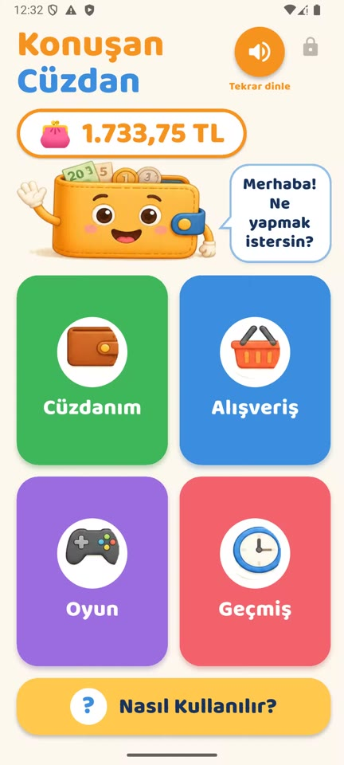</td>
    <td></td>
    <td>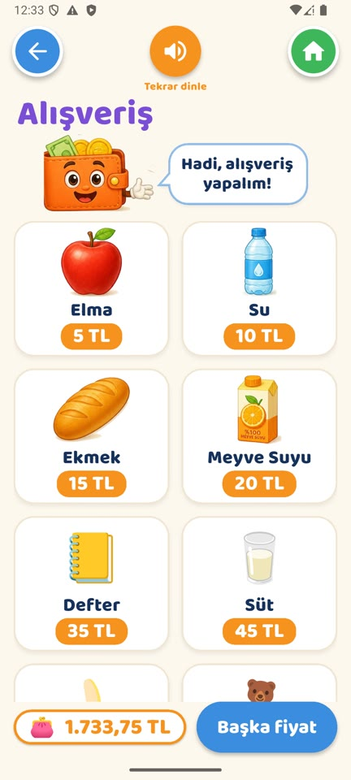</td>
    <td>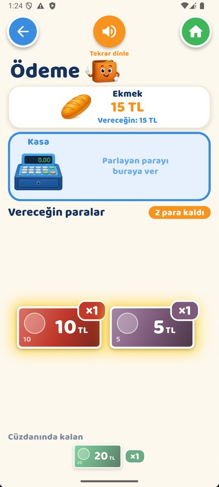</td>
  </tr>
  <tr>
    <th>Paran Yetmiyor</th>
    <th>Para Üstü</th>
    <th>Oyun</th>
    <th>Geçmiş</th>
  </tr>
  <tr>
    <td>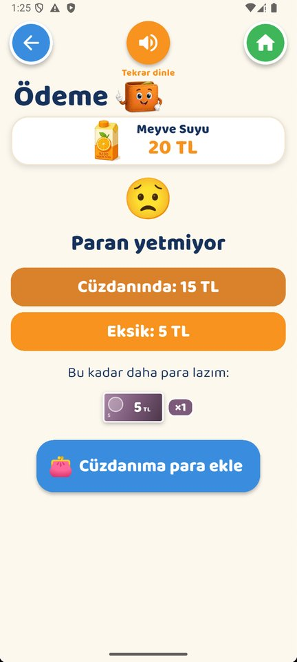</td>
    <td>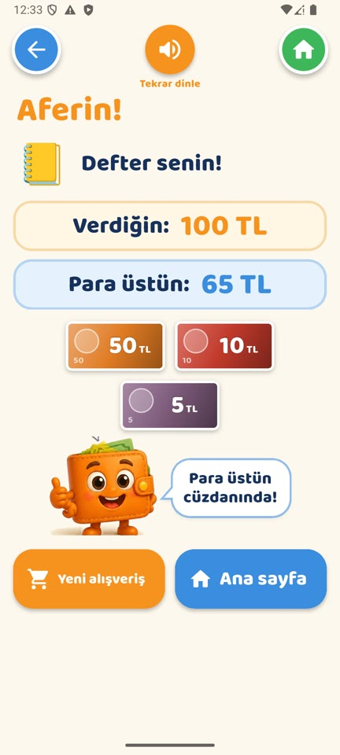</td>
    <td>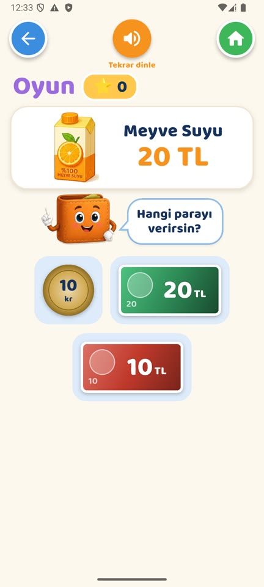</td>
    <td>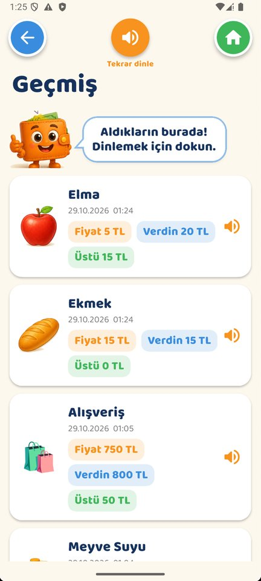</td>
  </tr>
  <tr>
    <th>Nasıl Kullanılır?</th>
    <th>Eğitmen Girişi</th>
    <th>Eğitmen Paneli</th>
    <th></th>
  </tr>
  <tr>
    <td>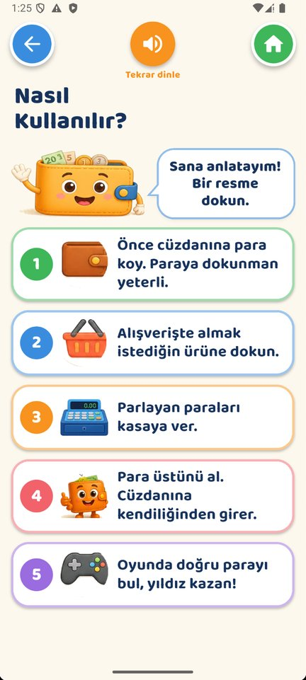</td>
    <td>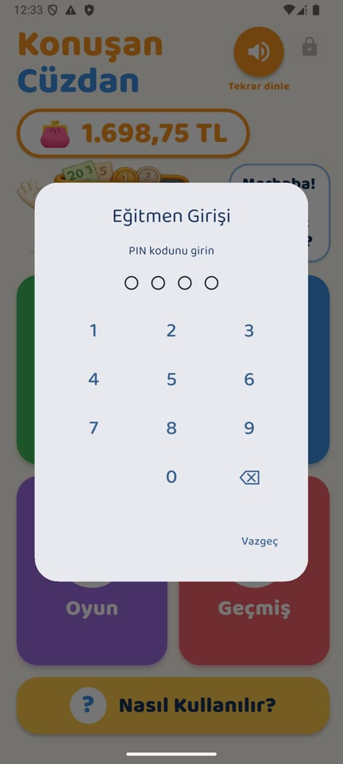</td>
    <td>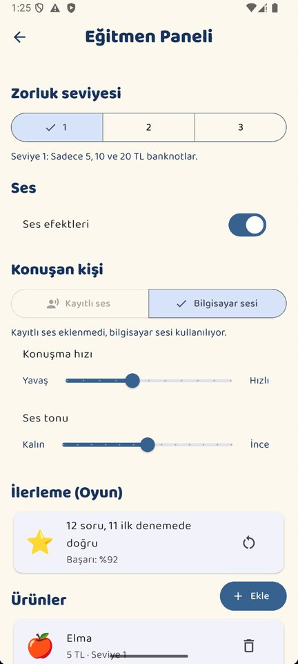</td>
    <td></td>
  </tr>
</table>

## Tasarım Yaklaşımı

Arayüz, Down sendromlu çocukların güçlü görsel öğrenme becerileri dikkate alınarak tasarlandı: büyük resimler ve butonlar, her ekranda tek ve kısa bir yönerge, tekrar dinlenebilen sesli anlatım, işin küçük adımlara bölünmesi (ürün seç → öde → para üstünü al) ve yanlış seçimde ceza yerine nazik ipucu.

> Uygulama eğitim amaçlıdır; para görselleri uygulama içinde çizilmiştir ve gerçek banknotların birebir kopyası değildir.
